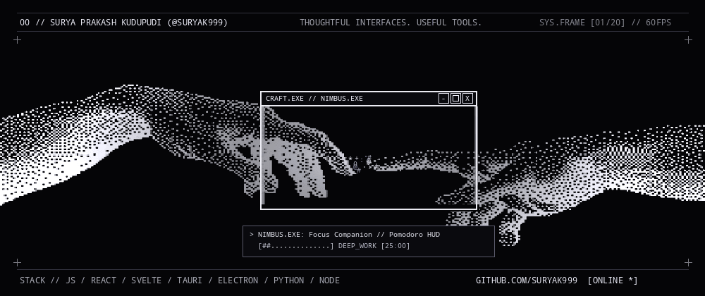
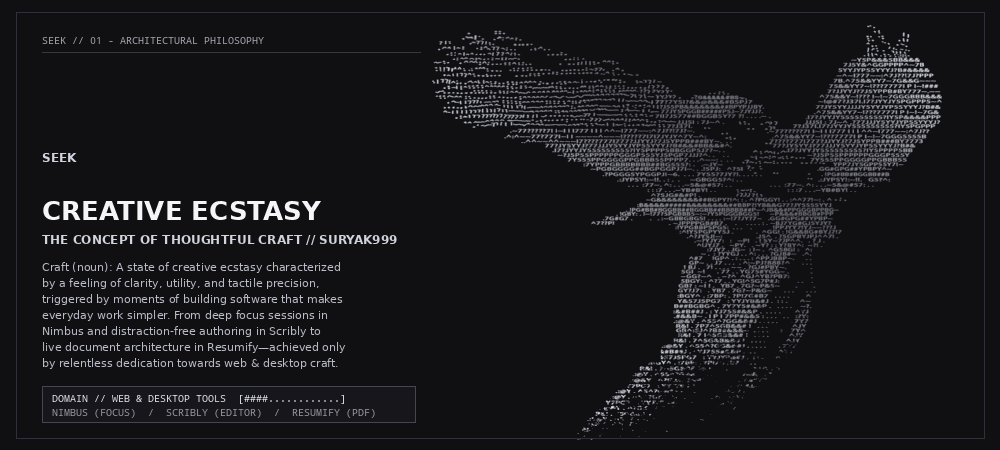
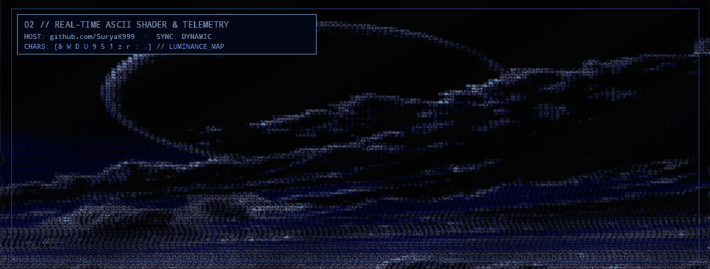

<div align="center">

<!-- ═══════════════════════════════════════════════════════════════════════════ -->
<!--         00 // CRAFT.EXE — BAYER-DITHERED CREATION HANDS & RETRO HUD         -->
<!-- ═══════════════════════════════════════════════════════════════════════════ -->

<a href="https://github.com/SuryaK999">
  
</a>

<br />

<a href="https://github.com/SuryaK999">
  
</a>

<p align="center">
  <a href="https://github.com/SuryaK999"></a>
  <a href="https://github.com/SuryaK999?tab=repositories"></a>
  <a href="mailto:suryak93813040@gmail.com"></a>
  <a href="https://github.com/SuryaK999"></a>
  <a href="https://github.com/SuryaK999"></a>
</p>

</div>

```text
+--------------------------------------------------------------------------------------------------+
| 00 // SURYA PRAKASH KUDUPUDI (@SuryaK999)        THOUGHTFUL INTERFACES. USEFUL TOOLS.  [-][□][X] |
+--------------------------------------------------------------------------------------------------+
|                                                                                                  |
|                                                         _.oo.                                    |
|     SEEK // 001                               _.u[[/;:,.         .odMMMMMM'                      |
|     THE ARCHITECTURE OF CRAFT              .o888UU[[[/;:-.  .o@P^    MMM^                        |
|     ─────────────────────────             oN88888UU[[[/;::-.        dP^                          |
|     I build web experiences and          dNMMNN888UU[[[/;:--.   .o@P^                            |
|     desktop tools that make             MMMMMMN888UU[[/;::-. o@^                                 |
|     everyday tasks simpler—             NNMMMNN888UU[[[/~.o@P^       ┌── PROJECT.EXE ── [-][X] ┐ |
|     from focused work and               888888888UU[[[/o@^-..        │ > NIMBUS   :: Focus HUD │ |
|     writing to creating                 oI8888UU[[[/o@P^:--..        │ > SCRIBLY  :: Code/Text │ |
|     a resume.                        .@^  YUU[[[/o@^;::---..         │ > RESUMIFY :: Live PDF  │ |
|                                    oMP     ^/o@P^;:::---..           └─────────────────────────┘ |
|     HOST   :: github.com/SuryaK999 .dMMM    .o@^ ^;::---...                                      |
|     SIGNAL :: suryak93813040@gmail dMMMMMMM@^`       `^^^^           LUMINANCE // [&WDU951zr:.]  |
|                                   YMMMUP^                                                        |
|                                    ^^                                                            |
+--------------------------------------------------------------------------------------------------+
```

## `01 // SEEK — CREATIVE ECSTASY & THE CONCEPT OF CRAFT`

<div align="center">
  <a href="https://github.com/SuryaK999?tab=repositories">
    
  </a>
</div>

<details open>
<summary><b><code>[+] VIEW RAW CHARACTER-DENSITY SCULPTURE // REZTOKIA_EAGLE.ASC (88x42 LUMINANCE FIELD)</code></b></summary>

```text
           .:7?1:..                                                                  .::.
       .^^!~:.  :~77~.. ..^^.                                                      :1JYYJ1:
     .~777~^^::..:~!177~:.  ..:..                                                .~Y5P&&&5BB&&&
   :!!7^^:..^^~..   ..:~77~..  ..:^^.                                           7J5Y&^GGPPPP^~7B
  :177!^:..^^!~:..:^^~...:~771-  ..:^77!-                                      5YYJYP55YYYJ?B#&&&&
    .:~!1777777111117777~^:..:^~!!~^:..:!777.                                 ~^~1777~~:^7J??!7J?PPP
      .~17771~^~!!111171~^::::^~!!77??Y5!?&&@&&&#B5PJ7                       7B.^75&&YY7~7G&&G~~~
        .~111777111711~^:::::^~!!7J55PB&&&&&&&&&#BPYPJJBY.                  ^75&&Y~!??77777I P I~!###
          .:~17777777777111~^:::~71I7J577##BGGB5Y77 ?!....~.               ~1@#77J37I.I77JYYJY5PGPPP5~^
              ..:~77777771!~!!1777111^^~1777~~:^7J??!7J?~.               .7?JYYJ7J5YPPB#BY777~.~^
                 .^:^~~777771~!1~~~~~^~~~!?????17I7JYJY^7Y~^:           .^75&&YY7~!??77777I P I~!~7G&
                    ..^^~~^^^^!????777I7777?JJYYJ?7J5YPPB###BY~.       .I7?JYYJY555555555?IYSP&&&&PPP
                         77?JY5YYJ?77JJJY5YYJYP55YYYJ?B#&&#BB&&^      7?J37I.I77JYYJY555555555?IYSPGPPP
                           .I7?JYYJY555555555?IYSPPPP5BBGGP5J7?~.   .~?J5P55PPPPPPPGGGP555Y
                             ~?J5P55PPPPPPPGGGP555YJ5PGP7JJJ?^.       7Y555PPGGGGPPGBBB55
                               7Y555PPGGGGPPGBBB55PPPP7...^~~:          YPP7JY5GPP55Y7!~
                                 :7YPPPGBBBBBBBB##BG555?:..~JY~          .GG#GPG##YPBPY^~
  SEEK                             ~PGBGGGG##BGPGGPJ7!~..!5PJ: ^?5!       .!PG#BB#BGGBB##B
                                     .?PGGG5YPGGPJI~6.  ..7Y55?7JY?!.      .:JYPSY!:~!!. G5?^:
  CREATIVE ECSTASY                      .:JYPSY!:~!!.. ..  ~GBGG5?^:..        ..:77~.^:...5&@#57:..
  ────────────────                         ..:77~.^:...~5&@#57:..                :::7...~YB#BY!..
  THE CONCEPT OF CRAFT                        :::7...~YB#BY!..
                                                ^?5JG&&#P!.       :7JJ?!:
  Craft (noun): A state of creative            ~G&&&&&&&&&&##BGPY?!^:..^7PGGY!:.:^^77!~:..^.:.
  ecstasy characterized by a feeling         :B&&&&#############&&&##BBP?!YB&&G777JY5555YYJ
  of clarity, utility, and pride,           !PG#BB#BGGBB##BGGBB##BBBBBB##P~^JB&&&PPGGGGBPPBG~
  triggered by building software          .!GBY:.!~17775PGBBB5~:~7Y5PGGGBGG5!  ~P&&&#BBGB#PPP
  that makes everyday work simpler.     .7G#G7.    .:~GBBGBG5!....:~!7?JY77~  .GG#GPG##YPBP~
  Achieved only by dedication         ^7??P!          .~JPPPPGB#B7.          .~BJ7YG#GJ5YJY?
  towards thoughtful interfaces.     .7^.^J?.           :!YPGBBPSP5G5:        !PPJYY7!YJ~~???J
                                    ~! :.7&B^            :^!Y5PGPYY5J.      .^GGI:!G&&BG#BYJ7!7
                                    !JYPB5.                .^7JYSJ!~:       J5^ .75GPBYJPJ^^7!.
                                                              .~?YJY7: : ~P! .!5Y~7JP^^. .?J.
                                                               ^!JYJ7. ~PY. .~Y?::Y?BY^: ~?!.
                                                                 :7JY7.JG~ :!-.^G58G!: ^:
                                                                 ~.:?YYGJ..^:...:?GJB#~ .^.
                                                               ^#7 !GP^.:...:^PPJBBP~.  ..
                                                               GP~..J7.... ^:~PJ7888?^   .
                                                              !BJ. 7!....~~.?GJ#PBY~.   .
                                                              5G! ~!  .77..YG75#YGG~.   .
                                                              ~GG?~^  .~?^ ^GJ^YB7PB7:
                                                              5BGY:.^77..YG!^5G7P#J:
                                                              GB?:~1!. YB7.7G?~P&5~
                                                             :BGY^.:7BP:.?P!7G#B7 ....   ^
                                                             Y&57J5PG7 :YYJYB&#J.::.  ^~
                                                            B##BGBG^.7Y7Y5#&&P. .... ~?.
                                                           :&#B##J.:YJ755#&&P.....  ^YJ
                                                           .##&B~.!?17PP#&&5:...   :?Y:
                                                          .:@&Y.^55^?GG&&#J.....  .7Y7
                                                           R&!.7P7^5GB&&#! ....   ^JY
                                                          .@&Y.^55^?GG&&#!..... .7Y/
                                                         :&#B##J.:YJ755#&&P...  .^
                                                        Y&57J5PG7 :YYJYB&#J.
                                                       :BGY^.:7BP:.?P!7G#B7
                                                      R&!.7^5GB&&#!
```

</details>

## `02 // FLAGSHIP DESKTOP & WEB SYSTEMS (INTERACTIVE .EXE INSPECTORS)`

| PROCESS ID | SYSTEM & ARCHITECTURAL PURPOSE | CORE RUNTIME | TELEMETRY & ACCESS |
| :--- | :--- | :--- | :--- |
| `01 // NIMBUS.EXE` | [**Nimbus**](https://github.com/SuryaK999/Nimbus-Focus-App) — A desktop focus companion with Pomodoro sessions and break reminders built for sustained deep work. | Desktop HUD · Timer State Engine · Notification Daemon | [](https://github.com/SuryaK999/Nimbus-Focus-App)   |
| `02 // SCRIBLY.EXE` | [**Scribly**](https://github.com/SuryaK999/Scribly-Text-Editor-App) — A desktop text editor with syntax highlighting, custom themes, and an integrated workspace sidebar. | Syntax AST · Custom Theme Engine · Workspace File Tree | [](https://github.com/SuryaK999/Scribly-Text-Editor-App)   |
| `03 // RESUMIFY.EXE` | [**Resumify**](https://github.com/SuryaK999/Resumify-Resume-Builder) — A modern resume builder featuring modular templates, real-time split-screen live preview, and instant PDF export. | Reactive Form State · Live DOM Preview · PDF Renderer | [](https://github.com/SuryaK999/Resumify-Resume-Builder)   |

<details open>
<summary><b><code>[+] EXECUTE INTERACTIVE WINDOW INSPECTOR // $ ./inspect_flagships.sh --ascii-wireframe</code></b></summary>

```text
  ┌── NIMBUS.EXE // FOCUS HUD ──── [-][□][X] ┐   ┌── SCRIBLY.EXE // EDITOR ────── [-][□][X] ┐   ┌── RESUMIFY.EXE // PDF COMPILER [-][□][X] ┐
  │ STATE :: POMODORO_ACTIVE      SESSION #04│   │ WORKSPACE  │ src/theme_engine.js     [*] │   │ SCHEMA_INPUT  │ LIVE_A4_PREVIEW.PDF      │
  ├──────────────────────────────────────────┤   ├────────────┼─────────────────────────────┤   ├───────────────┼──────────────────────────┤
  │              .::@@@@@@@@::.              │   │ ▾ scribly/ │ 01 const palette = {        │   │ > Identity    │ ════════════════════════ │
  │          .:@@88888888888888@@:.          │   │   main.js  │ 02   bg: '#09090B',         │   │   Surya P. K. │ SURYA PRAKASH KUDUPUDI   │
  │        .@8888888888888888888888@.        │   │   ast.js   │ 03   fg: '#F4F4F5',         │   │ > Experience  │ Web & Desktop Engineer   │
  │       .@88888 [  24 : 59  ] 88888@.      │   │   ui.css   │ 04   accent: '#38BDF8'      │   │   [+ Add Row] │ ──────────────────────── │
  │       .@88888  DEEP  FOCUS  88888@.      │   │ ▾ themes/  │ 05 };                       │   │ > Projects    │ • Nimbus Focus Companion │
  │        .@8888888888888888888888@.        │   │   noir.json│ 06 export default palette;  │   │   • Nimbus    │ • Scribly Text Editor    │
  │          ':@@88888888888888@@:'          │   │   ice.json │ 07 // AST Highlighting ON   │   │   • Scribly   │ • Resumify PDF Builder   │
  ├──────────────────────────────────────────┤   ├────────────┴─────────────────────────────┤   ├───────────────┴──────────────────────────┤
  │ [ ▶ START ]   [ ⏸ PAUSE ]   [ ↻ BREAK ] │   │ UTF-8  │  LN 06, COL 24  │  THEME: NOIR  │   │ STATUS: SYNCED  │  [ 📥 EXPORT PDF 1:1 ] │
  └──────────────────────────────────────────┘   └──────────────────────────────────────────┘   └──────────────────────────────────────────┘
```

- **Launch Nimbus Repository**: [github.com/SuryaK999/Nimbus-Focus-App](https://github.com/SuryaK999/Nimbus-Focus-App)
- **Launch Scribly Repository**: [github.com/SuryaK999/Scribly-Text-Editor-App](https://github.com/SuryaK999/Scribly-Text-Editor-App)
- **Launch Resumify Repository**: [github.com/SuryaK999/Resumify-Resume-Builder](https://github.com/SuryaK999/Resumify-Resume-Builder)
- **Browse All Repositories**: [github.com/SuryaK999?tab=repositories](https://github.com/SuryaK999?tab=repositories)

</details>

## `03 // REAL-TIME DYNAMIC REPOSITORY STREAM (AUTO-FETCHED ON UPDATE)`

<!-- DYNAMIC_PROJECTS:START -->
> **LIVE TELEMETRY STREAM** · Auto-synced via GitHub API (`GET /users/SuryaK999/repos?sort=updated`) · Powered by `.github/workflows/sync_projects.yml`

| PROCESS ID | REPOSITORY & ARCHITECTURAL PURPOSE | RUNTIME | DENSITY PULSE | UPDATED / STARS |
| :--- | :--- | :--- | :--- | :--- |
| `01 // NIMBUS-FOCUS-APP.EXE` | [**Nimbus-Focus-App**](https://github.com/SuryaK999/Nimbus-Focus-App) — A desktop focus companion with Pomodoro sessions and break reminders. | `Desktop / JS` | `[@#W8&U51zr:.....]` |  |
| `02 // SCRIBLY-TEXT-EDITOR-APP.EXE` | [**Scribly-Text-Editor-App**](https://github.com/SuryaK999/Scribly-Text-Editor-App) — A desktop text editor with syntax highlighting, custom themes, and a workspace sidebar. | `Desktop / JS` | `[@#W8&U51zr......]` |  |
| `03 // RESUMIFY-RESUME-BUILDER.EXE` | [**Resumify-Resume-Builder**](https://github.com/SuryaK999/Resumify-Resume-Builder) — A resume builder with templates, live preview, and PDF export. | `Web / JS` | `[@#W8&U51z.......]` |  |
<!-- DYNAMIC_PROJECTS:END -->

## `04 // TOOLS IN MY PROJECTS & ARCHITECTURAL STACK`

```text
+--------------------------------------------------------------------------------------------------+
| LAYER // 01  FRONTEND ARCHITECTURE      Vanilla JS  ·  React  ·  Svelte  ·  Tailwind/CSS  ·  HTML5|
|              LUMINANCE DENSITY          [@@@@@@@@@@@@@@@@@@@@@@####****::..]  94%                |
+--------------------------------------------------------------------------------------------------+
| LAYER // 02  DESKTOP APPLICATION CRAFT  Tauri  ·  Electron.js  ·  CustomTkinter (Python)         |
|              LUMINANCE DENSITY          [@@@@@@@@@@@@@@@@@@@#####****:::...]  89%                |
+--------------------------------------------------------------------------------------------------+
| LAYER // 03  BACKEND & SERVICE RUNTIME  Node.js  ·  Express.js  ·  REST & Local File I/O         |
|              LUMINANCE DENSITY          [@@@@@@@@@@@@@@@@#####*****:::::...]  82%                |
+--------------------------------------------------------------------------------------------------+
```

| Architectural Layer | Technologies & Runtimes | Engineering Focus |
| :--- | :--- | :--- |
| **Frontend Systems** |       | Tactile micro-interactions, zero-jank state management, live document previewing, and crisp typography |
| **Desktop Craft** |    | Native-feeling window chrome, low-memory background timers, filesystem workspaces, and offline-first utilities |
| **Backend & Runtime** |   | Fast local IPC/HTTP bridges, automated build pipelines, and modular API architecture |

## `05 // COBALT HORIZON — REAL-TIME TELEMETRY & DOT-MATRIX WAVE`

<div align="center">
  <a href="https://github.com/SuryaK999">
    
  </a>
</div>

<details>
<summary><b><code>[+] VIEW DOT-MATRIX WAVE & DEMOSCENE GALLERY // WAVE_MATRIX.ASC + SHARK_SCENE.ASC</code></b></summary>

```text
+--------------------------------------------------------------------------------------------------+
| ***********************************@@@********************************************************** |
| ******************************@@@@@@@@@*@@@***************************************************** |
| **************************@@@@@@@@@@@@*@@@@@@*************************************************** |
| ***********************@@@@@@@@@@@@@@@.@@@@@@@************************************************** |
| *******************@@@@@@@@@*@*..**..***@@@@@@@************************************************* |
| *****************@@@@@@@@@*@*.........****@@@@@@@*********************************************** |
| **************@@@@@@@@@@@.*............*****@@@@@@@********************************************* |
| **********@@@@@@@@@@@@@.................*****@@@@@@@@*@***************************************** |
| *******.@@@@@@@@@@@@@@@..................*****@@@@@@@@@***************************************** |
| ...@@@@@@@*@@@@*@@@@@@@*..................******@@@@*@@@@***************************************. |
| @@@@@@@*.@@*@@@@..*..**@@@.................*******@@@@*@@@@***********************************.@@ |
| @@@****...@@@@*..*.@.....@@@................********@@@@@************************************.@@@ |
| @@*****........@@@@@@@....@@@...............*********@@@@************************************@@@@ |
| @@**...........*@@@@@@@....................**********@@@************************************@@@@* |
| @**@.*.........@.*..@@@.....................**********************************************@@@@@*. |
| @@***..........@.............@@@............*********************************************@@@@**.. |
| @***........................@@@@@...........*******************************************@@@@@***.. |
| .@@***.....................@@@@@@@..........****************************************.@@@@***....@ |
| ..*.......................@@@@@@@@@@@.......************@@@@@****................@@@@****.....@@@ |
| ........................@@@@@@@@*@@@@@@.....**********@@@@@***.....@*.*.........@*..*.......@@@@@ |
| @@@@@@@.@@@@@@@@@@@@@@@*@@**@@@.@@@@........@@@.....@..@.@.......@*.*......@@@...@@@@@@@@*.@@@@** |
| @@@@@@@@@@@@@@@@@@@@@@@@@***@@...@@@........@*.......*.@*@**....@@@@@*...@@@@@*..@@@@@@@@.@@@@*** |
| @@@***@@@@@@@@@**@*****@@**.......@........*.*....@@@@@@@@@@**@@@@@@@@**.@@@@@*..@@@***@**.*..... |
| @@@@@*****@**.*@***@@@@@**.*....@...@...........**@@@@*@@@@@**@@@@@@@@*...@@@@@**.....*..*@@@*.*@ |
| @@@..@@........**.****@@@*.*...*..**..........@@@@@@@@...**....**@..@@@@@**@@@@...**@............ |
| @@...................***..*****.*..@@...................@@@@*.......**.****@@@@@@@@@@****@@@***** |
| @@@@.......................*.*.*.*.*...@@@@@@@@@@@@@@@@@@@@@****.*@@@@@@@@@@@@@@@@@@@@@@@@@@@@@@@ |
+--------------------------------------------------------------------------------------------------+
                                                                        // DOT-MATRIX WAVE VIEWPORT

                                             _,,                                     ,dW
                                           ,iSMP                                    JIl;
                                          sPT1Y'                                   JWS:'
                                         sIl:l1                                   fWIl?
                                        dIi:Il;                                  fW1"
                                       dIi:l:I'                                 fWI:
                                      dIli:l:I;                                fWI:
                                    .dIli:I:S:S                     .         fWIl`
                                  ,sWSSIIIiISIIS w,_             .sMW       ,MWIl;
                             _.,sWWW*"'*" , SWW' MWWMm mu,,._  .iSYISb, ,MM*SI!:
                         _,s YMMWW'',sd,'MM WMMi "*MW* WWWMWMb MMS WWP`,MW' S1!`
                    _,os,'MMi YW' m,'WW; WWb`SWM Im,,  SIS ISW SISIP*  WSi  II!.
                 .osSMWMW,'WSi ',MMP SSb WSW ISII`SYYi III !Il lIi,ui:,*1:li:l1!
              ,sSMMWWWSSSS,'SWbdWW*  *YSbiSS:'IlI 7llI il1: l! 'l:+'+l; `''+1i:1i
           ,sYSMWMWY**"*"`' 'WWSSIIiu,'**Y11';IIIb ?!li ?l:i,         `      `'l!:
          sPITMWMW'`.M.wdWWb,'YIi `YT" ,u!1",ISIWWm,'+?+ `'+Ili                `'l:,
          YIi1lTYfPSkyLinedI!i`I!" .,:!1"',iSWWMMMMMmm,
            "T1l1lI**"'`.2006? ',o?*'``  ```""**YSWMMMWMm,
                 "*:iil1I!I!"` '                 ``"*YMMWWM,
                       ii!                             '*YMWM,
                       I'                                  "YM          // DEMOSCENE CHARACTER SHARK
```

</details>

<div align="center">

<a href="https://github.com/SuryaK999">
  
</a>
<a href="https://github.com/SuryaK999">
  
</a>

<br />

<a href="https://github.com/SuryaK999">
  
</a>

</div>

## `06 // LET'S CONNECT — DIRECT SIGNAL CHANNEL`

```text
+--------------------------------------------------------------------------------------------------+
| $ ./open_signal_channel.sh --target="Surya Prakash Kudupudi (@SuryaK999)"            [-][□][X]   |
+--------------------------------------------------------------------------------------------------+
|                                                                                                  |
|   PROMPT      ::  Have an idea to discuss or a question about my work?                           |
|   DIRECT MAIL ::  suryak93813040@gmail.com                                                       |
|   GITHUB HOST ::  https://github.com/SuryaK999                                                   |
|   ALL REPOS   ::  https://github.com/SuryaK999?tab=repositories                                  |
|   STATUS      ::  [ONLINE ●] BUILDING THOUGHTFUL INTERFACES & USEFUL TOOLS                       |
|                                                                                                  |
+--------------------------------------------------------------------------------------------------+
```

<p align="center">
  <a href="mailto:suryak93813040@gmail.com"></a>
  <a href="https://github.com/SuryaK999"></a>
</p>
