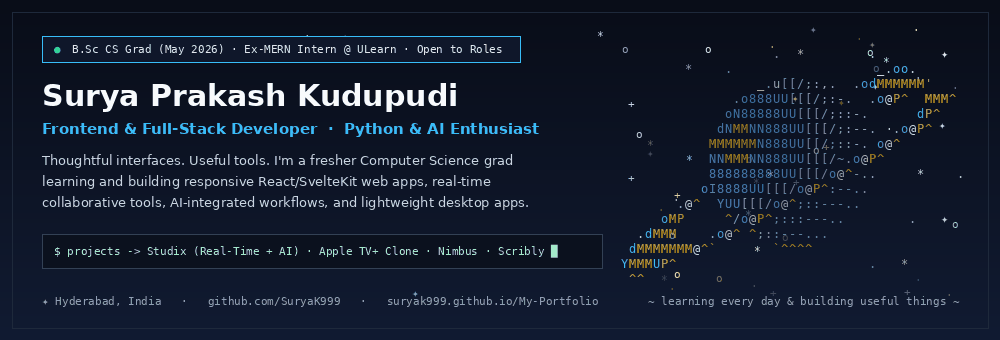
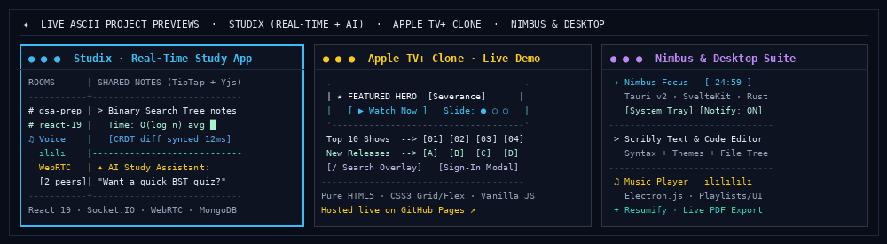
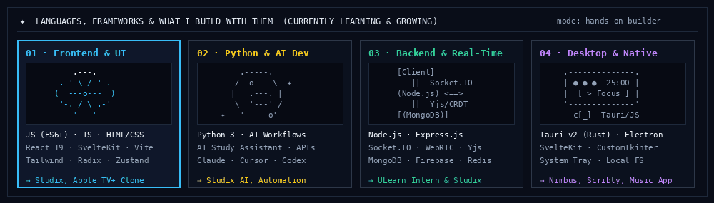
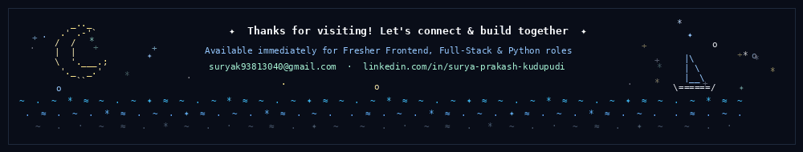

<div align="center">

<a href="https://github.com/SuryaK999">
  
</a>

<br />

<a href="https://github.com/SuryaK999">
  
</a>

<p align="center">
  <a href="https://www.linkedin.com/in/surya-prakash-kudupudi"></a>
  <a href="https://suryak999.github.io/My-Portfolio/"></a>
  <a href="https://github.com/SuryaK999?tab=repositories"></a>
  <a href="mailto:suryak93813040@gmail.com"></a>
</p>

</div>

<table>
<tr>
<td width="60%" valign="top">

### 👋 About Me

**Thoughtful interfaces. Useful tools.**

I'm a **Computer Science graduate (B.Sc CS, May 2026 · CGPA: 8.5/10)** based in **Hyderabad, Telangana, India**, with hands-on experience from a **3-month MERN Stack Internship at ULearn (Apr – Jun 2025)**.

I'm currently in an active learning and building phase—focusing on writing clean, responsive frontend interfaces (`React.js`, `JavaScript ES6+`, `TypeScript`, `SvelteKit`, `Tailwind CSS`), wiring real-time full-stack features (`Node.js`, `Express.js`, `Socket.IO`, `WebRTC`, `MongoDB`), exploring `Python` & AI-assisted workflows (`Claude`, `Cursor`, `ChatGPT Codex`), and packaging lightweight desktop apps (`Tauri v2`, `Electron.js`).

- 🌱 **Currently learning**: Deeper TypeScript patterns, real-time state sync (`Yjs` / WebSockets), and Python + AI integrations
- 💼 **Internship**: **MERN Stack Intern @ ULearn** *(Apr 2025 – Jun 2025)* — Integrated REST APIs into React.js sprints, fixed state-management UI bugs, and contributed to Express/MongoDB routing & code reviews
- 🎯 **Looking for**: **Fresher Frontend Developer, Full-Stack Developer (MERN), or Python / Software Engineer** roles *(Available immediately — on-site, hybrid, or remote)*

</td>
<td width="40%" valign="top">

```yaml
#  *    .     ✦     .         *
#    .    night-sky.asc    _.oo.
#              _.u[[/;:,.odMMMMMM'
#           .o888UU[[[/;:-. .o@P^
#          oN88888UU[[[/;::-. dP^
#         dNMMNN888UU[[[/;:--.o@P^
#         888888888UU[[[/o@^-..   ✦
#      .@^  YUU[[[/o@^;::---..
#    oMP     ^/o@P^;:::---..   *
# .dMMM    .o@^ ^;::---...
# YMMMUP^   .       *        .

name:       "Surya Prakash Kudupudi"
education:  "B.Sc CS (May 2026) · 8.5 CGPA"
experience: "MERN Intern @ ULearn (3 mos)"
location:   "Hyderabad, Telangana, India"
status:     "Fresher · Open to Roles ✨"
```

</td>
</tr>
</table>

## 🚀 Projects I've Built *(And What I Learned)*

<div align="center">
  <a href="https://github.com/SuryaK999?tab=repositories">
    
  </a>
</div>

### 1. Core Web & Desktop Projects

| Project | What I Built & Learned | Tech Stack | Links & Activity |
| :--- | :--- | :--- | :--- |
| 💬 [**Studix — Real-Time Collaborative Study Platform**](https://github.com/SuryaK999/Studix-Web-App) | Built a Discord-style study space with rooms, live chat, shared notes, tasks, and an **AI study assistant**. Learned how to sync live collaborative notes using **TipTap + Yjs (CRDT)** binary diffs over **Socket.IO**, build **WebRTC** voice channels with custom SDP/ICE signaling, and manage UI state with **Zustand & Radix UI**. | `React 19` · `Vite` · `Tailwind CSS` · `Radix UI` · `Zustand` · `TipTap` · `Yjs` · `Socket.IO` · `WebRTC` · `Node.js` · `MongoDB` · `Firebase` · `Redis` | [](https://github.com/SuryaK999/Studix-Web-App)  |
| 📺 [**Apple TV+ Web Clone**](https://github.com/SuryaK999/Apple-Tv-Web-Clone) | Built a responsive Apple TV+ streaming interface in pure **HTML5, CSS3, and Vanilla JavaScript** without frameworks. Implemented a hero banner carousel, horizontally scrollable content rows (*Top 10 Shows/Movies, New Releases, Nature, Music*), a live search overlay, and a multi-step sign-in modal using CSS Grid/Flexbox transitions. | `HTML5` · `CSS3 (Flexbox & Grid)` · `Vanilla JavaScript (ES6+)` · `GitHub Pages` | [](https://suryak999.github.io/Apple-Tv-Web-Clone/) [](https://github.com/SuryaK999/Apple-Tv-Web-Clone) |
| 🎯 [**Nimbus — Smart System Tray Focus App**](https://github.com/SuryaK999/Nimbus-Focus-App) | Built a lightweight cross-platform Pomodoro focus companion for Windows, macOS, and Linux. Used **SvelteKit & Tailwind CSS** for a clean UI and **Tauri v2 + Rust plugins** for native OS notifications, background timers, and local persistence. | `Tauri v2` · `SvelteKit` · `TypeScript` · `Tailwind CSS` · `Rust` | [](https://github.com/SuryaK999/Nimbus-Focus-App)  |
| 🎵 [**Desktop Music Player**](https://github.com/SuryaK999/Mini-Music-Desktop-Player-) | Built a desktop audio player with play/pause/seek and volume controls, playlist management, and switchable dark/light UI themes (also explored a Python `CustomTkinter` + `pygame.mixer` mini version). | `Electron.js` · `JavaScript` · `HTML5` · `CSS3` · `Python / CustomTkinter` | [](https://github.com/SuryaK999/Mini-Music-Desktop-Player-)  |

### 2. More Tools & UI Builds

<table>
<tr>
<td width="60%" valign="top">

- ✍️ **[Scribly — Desktop Text Editor](https://github.com/SuryaK999/Scribly-Text-Editor-App)**: A clean desktop text and code editor with syntax highlighting, custom color themes, and a workspace folder sidebar (`Electron.js` · `JavaScript` · `CSS3`).
- 📄 **[Resumify — Interactive Resume Builder](https://github.com/SuryaK999/Resumify-Resume-Builder)**: A browser-based resume tool with structured templates, live side-by-side preview as you type, and instant A4 PDF export (`React` / `JavaScript` · `Tailwind CSS`).
- 🌐 **[Personal Developer Portfolio](https://suryak999.github.io/My-Portfolio/)** ([Repo](https://github.com/SuryaK999/My-Portfolio)): My personal portfolio website showcasing my projects, skills, and contact links, hosted on GitHub Pages (`HTML5` · `CSS3` · `JavaScript`).

</td>
<td width="40%" valign="top">

```diff
+ ✦ how studix syncs in real time:

  [React 19 + TipTap Editor]
        │  ▲
        ▼  │ (Yjs CRDT binary diffs)
  [Socket.IO + WebRTC Signaling]
        │  ▲
        ▼  │ (REST + Auth + Cache)
  [Node.js · MongoDB · Redis · AI]
```

</td>
</tr>
</table>

## 🛠️ Languages, Tech Stack & What I Practice With

<div align="center">
  
</div>

<table>
<tr>
<td width="58%" valign="top">

| Category | Technologies I Use & Practice |
| :--- | :--- |
| **Languages** | `Python` · `JavaScript (ES6+)` · `TypeScript` · `HTML5` · `CSS3` |
| **Frontend** | `React.js (React 19)` · `Vite` · `SvelteKit` · `Tailwind CSS` · `Radix UI` · `Zustand` · `Framer Motion` |
| **Backend & Real-Time** | `Node.js` · `Express.js` · `REST APIs` · `Socket.IO` · `WebSockets` · `WebRTC` |
| **Databases & Cloud** | `MongoDB` · `PostgreSQL` · `Firebase (Auth, Firestore)` · `Redis` · `Supabase` |
| **Desktop & Tools** | `Tauri v2` · `Electron.js` · `Git` · `GitHub` · `GitHub Pages` · `Vercel` · `Render` |
| **AI-Assisted Dev** | `Claude` · `Cursor` · `ChatGPT Codex` *(for faster debugging, prototyping & learning)* |

</td>
<td width="42%" valign="top">

```yaml
#  ✦ mini tech ascii art: react + python + desk

      .-' \ / '-.         .-----.
     (  ---o---  )       /  o    \  ✦
      '-. / \ .-'       |   .---. |
      [React / UI]       \  '---' /
                          '-----o' [Python]

  [JS] [TS] [Py] [React] [Svelte] [Node]
   ( (
    ) )    .--------------------------.
  .____.   | ● ● ●  learning & coding |
  |    |]  | > npm run dev            |
  \____/   '--------------------------'
```

</td>
</tr>
</table>

<p align="center">
  
  
  
  
  
  
  
  
  
  
  
  
  
</p>

## 🔄 Live Repository Feed *(Auto-Synced with My GitHub)*

<!-- AUTO-PROJECTS:START -->
> *Automatically synced with [@SuryaK999's public repositories](https://github.com/SuryaK999?tab=repositories) via GitHub Actions (Last checked: `2026-10-16`)*

| Repository | What it does | Primary Stack | Activity | Last Pushed / Stars |
| :--- | :--- | :--- | :--- | :--- |
| [**Resumify-Resume-Builder**](https://github.com/SuryaK999/Resumify-Resume-Builder) · [Live ↗](https://suryak999.github.io/Resumify-Resume-Builder/) | This Site Is About Creating Your Own "Resume/Cv" by readymade design in "traditional" or "Bento Box" Layout Design.... | `JavaScript` | `██████████` | `2026-05-30` · ★ 2 |
| [**Sign-up-wizard-application-frontend**](https://github.com/SuryaK999/Sign-up-wizard-application-frontend) · [Live ↗](https://signup-page-orpin.vercel.app) | React frontend application  | `JavaScript` | `██████████` | `2026-09-20` · ★ 1 |
| [**Calculator**](https://github.com/SuryaK999/Calculator) · [Live ↗](https://suryak999.github.io/Calculator/) | Created Calculator using HTML, CSS, JS | `JavaScript` | `██████████` | `2026-02-07` · ★ 1 |
| [**Nimbus-Focus-App**](https://github.com/SuryaK999/Nimbus-Focus-App) | 🌿 A premium, ultra-lightweight system tray focus companion app "Nimbus 🌿" built with Tauri v2, Rust, SvelteKit, and Svelte 5. Features Pomodoro timers, native OS notifications, local persistence, and zero-asset programmatically synthesized audio alerts. Designed with sleek look and distraction-free auto-hide on blur. | `Svelte` | `█████████░` | `2026-06-01` · ★ 2 |
| [**Python-Calculator**](https://github.com/SuryaK999/Python-Calculator) | Created Calculator using Python with responsive design and with Basic mathematical Abilities like Addition,Subtract,Multiply,Division,Modular Division and it has Clean Error Handling and Old School Design..... | `Python` | `█████████░` | `2026-06-01` · ★ 2 |
| [**Apple-Tv-Web-Clone**](https://github.com/SuryaK999/Apple-Tv-Web-Clone) · [Live ↗](https://suryak999.github.io/Apple-Tv-Web-Clone/) | Created Apple Tv Web Clone Using HTML, CSS, JS Only... | `CSS` | `██████████` | `2026-06-02` · ★ 3 |
| [**Scribly-Text-Editor-App**](https://github.com/SuryaK999/Scribly-Text-Editor-App) | ✍️ Scribly — A sleek, feature-rich desktop text editor built with Python & CustomTkinter. Real-time syntax highlighting, 6+ stunning themes with a custom theme creator, smart auto-indent, bracket matching, advanced Find & Replace, integrated file explorer, and zoom controls. Code beautifully. ⚡ | `Python` | `█████████░` | `2026-06-02` · ★ 2 |
| [**github-dashboard**](https://github.com/SuryaK999/github-dashboard) | About my Account | `Web / JS` | `█████████░` | `2026-07-27` · ★ 2 |
<!-- AUTO-PROJECTS:END -->

## 📊 GitHub Activity & Stats

<div align="center">

<a href="https://github.com/SuryaK999">
  
</a>
<a href="https://github.com/SuryaK999">
  
</a>

<br />

<a href="https://github.com/SuryaK999">
  
</a>

</div>

## 🎓 Education & Let’s Connect

<table>
<tr>
<td width="62%" valign="top">

- 🎓 **B.Sc in Computer Science** — *Aditya Degree College, Amalapuram* *(Graduated May 2026 · CGPA: 8.5 / 10.0)*
- 💼 **MERN Stack Intern** — *ULearn, Amalapuram* *(April 2025 – June 2025)*
- 📫 **Email**: [suryak93813040@gmail.com](mailto:suryak93813040@gmail.com)
- 🔗 **LinkedIn**: [linkedin.com/in/surya-prakash-kudupudi](https://www.linkedin.com/in/surya-prakash-kudupudi)
- 🌐 **Portfolio**: [suryak999.github.io/My-Portfolio](https://suryak999.github.io/My-Portfolio/)

</td>
<td width="38%" valign="top">

```yaml
      |\__/,|   (`\    *  .  ✦
    _.| o o  |_   ) )
  -(((---(((---------
  # always learning, building &
  # open to fresher dev roles! ✨
```

</td>
</tr>
</table>

<div align="center">
  <a href="mailto:suryak93813040@gmail.com">
    
  </a>
</div>
